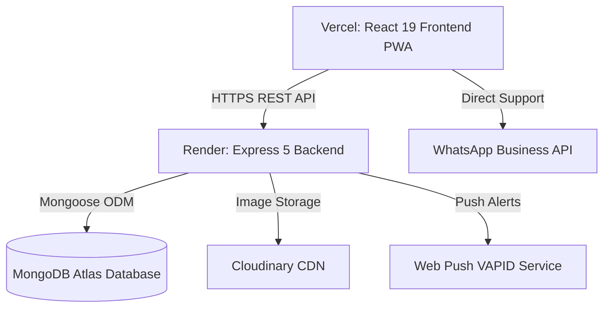

# 🏕️ Pawna Camping — Full-Stack Booking & Management Platform

[](https://pawna-camping.vercel.app)
[](https://pawna-camping.onrender.com)
[](https://react.dev/)
[](https://nodejs.org/)
[](https://www.mongodb.com/)

A modern, production-ready, full-stack web application designed for booking and managing lakeside campsites and luxury villas around Pawna Lake and Lonavala. 

Built with **React 19**, **Vite**, **Tailwind CSS 4**, **Node.js (Express 5)**, and **MongoDB**, featuring real-time booking confirmation, multi-role dashboards for managers and property owners, image uploads, and progressive web app (PWA) support.

---

## 🌟 Features Overview

### 1. 👥 Guest Experience (Public Website)
* **Discover Stays**: Browse curated campsites and private luxury villas with photo galleries, amenities lists, and interactive highlights.
* **Smart Booking Engine**:
  * Date picker with automated availability checks and night calculation.
  * Headcount and meal distribution (Veg vs. Non-Veg) validation.
  * Real-time price breakdown with package add-ons and promotional discounts.
* **Instant Confirmation**: Generates a unique booking reference code (`#PC-XXXXXX`), downloadable summary, and direct WhatsApp contact link.
* **Direct WhatsApp Integration**: One-click WhatsApp chat for personalized guest support.
* **Reviews & Ratings**: Verified customer testimonials and dynamic rating submissions.
* **Mobile PWA Support**: Installable on iOS and Android devices with offline asset caching.

---

### 2. 🛠️ Manager Portal (`/manager`)
* **Role-Protected Access**: Secure JWT authentication with automatic session expiration checks.
* **Dashboard & Metrics**: Real-time revenue summaries, booking status counts, and recent reservation feeds.
* **Property Management**: Create, update, or archive campsite and villa listings with multi-image Cloudinary uploads.
* **Package Management**: Add custom stay packages with pricing, meal inclusions, and check-in/out rules.
* **Booking Operations**: Search, filter by status (Pending, Confirmed, Cancelled), and export reservations to CSV.
* **Owner Accounts**: Assign properties to independent property owners with custom login credentials.
* **Analytics & Reports**: Visual revenue trends and property-wise earnings powered by Recharts.
* **Web Push Notifications**: Receive browser push notifications instantly when a new booking arrives.

---

### 3. 🏡 Property Owner Dashboard (`/owner`)
* **Dedicated Login**: Independent portal for villa and campsite owners.
* **Calendar Date Blocking**: Block dates for private use or maintenance to immediately prevent guest bookings.
* **Reservation Feed**: View guest headcounts, meal preferences, check-in dates, and contact details for assigned properties.
* **Earnings Overview**: Track property-specific revenue and performance.

---

## 🏗️ Architecture & Tech Stack



| Layer | Technologies |
| :--- | :--- |
| **Frontend** | React 19, Vite 7, Tailwind CSS 4, React Router 6, Framer Motion, Lucide React, Recharts |
| **Backend** | Node.js, Express 5, Mongoose 9, JWT, Helmet, Morgan, Express Mongo Sanitize, Compression |
| **Database** | MongoDB Atlas |
| **Media & Assets** | Cloudinary CDN |
| **Notifications** | Web-Push (VAPID) |
| **Hosting** | Vercel (Frontend), Render (Backend) |

---

## 📁 Project Structure

```text
Pawna-camping/
├── public/                 # Static assets, PWA icons, manifest
├── src/
│   ├── assets/             # Images and local SVG icons
│   ├── components/         # Reusable UI components (Hero, Booking, Reviews, etc.)
│   │   └── manager/        # Manager-specific components (ImageUploader)
│   ├── config/             # Centralized API configuration (api.js)
│   ├── context/            # Global contexts (ToastContext, PromotionContext)
│   ├── pages/              # Public views (CampsiteDetail, VillaDetail, BookingPage)
│   │   ├── manager/        # Manager views (Dashboard, Bookings, Revenue, Packages)
│   │   └── owner/          # Owner views (BlockedDatesManagement)
│   ├── App.jsx             # Route definitions & ProtectedRoute guards
│   ├── index.css           # Tailwind CSS 4 theme & styles
│   └── main.jsx            # React root mount
├── backend/
│   ├── config/             # Database connection (db.js)
│   ├── controllers/        # Business logic for all endpoints
│   ├── middleware/         # Auth verification & role guards
│   ├── models/             # Mongoose schemas (User, Booking, Property, Package, etc.)
│   ├── routes/             # Express API route declarations
│   ├── tests/              # Backend integration test suites
│   ├── server.js           # Express app entrypoint & middleware pipeline
│   └── package.json        # Backend dependencies & scripts
├── tests/                  # Challenger & client test suites
├── package.json            # Frontend dependencies & scripts
├── vite.config.js          # Vite configuration & PWA plugin
└── vercel.json             # Vercel SPA routing redirects
```

---

## 🚀 Quick Start Guide (For First-Timers)

Follow these steps to get the project running locally on your computer.

### 1. Prerequisites
Make sure you have installed on your machine:
* [Node.js](https://nodejs.org/) (Version 18 or higher recommended)
* [Git](https://git-scm.com/)
* A free [MongoDB Atlas](https://www.mongodb.com/cloud/atlas) account (or a local MongoDB instance)

---

### 2. Clone the Repository
Open your terminal (PowerShell, Command Prompt, or Terminal) and run:
```bash
git clone https://github.com/kaustubh12022/Pawna-camping.git
cd Pawna-camping
```

---

### 3. Set Up the Backend
Open a terminal in the `backend` folder:
```bash
cd backend
npm install
```

Create a `.env` file inside the `backend` folder (you can copy from `.env.example`):
```env
PORT=5000
NODE_ENV=development
MONGODB_URI=mongodb+srv://<username>:<password>@cluster0.mongodb.net/pawna-camping?retryWrites=true&w=majority
JWT_SECRET=your_super_secret_jwt_key_here

# Optional: Cloudinary (for image uploads)
CLOUDINARY_CLOUD_NAME=your_cloud_name
CLOUDINARY_API_KEY=your_api_key
CLOUDINARY_API_SECRET=your_api_secret

# Optional: Web Push Notifications
VAPID_PUBLIC_KEY=your_vapid_public_key
VAPID_PRIVATE_KEY=your_vapid_private_key

# Frontend URL for CORS
FRONTEND_URL=http://localhost:5173
```

Start the backend server:
```bash
npm start
```
> You should see: `[ SUCCESS ] SERVER RUNNING IN development MODE ON PORT 5000` and `[ SUCCESS ] MONGODB CONNECTED`.

---

### 4. Set Up the Frontend
Open a **new** terminal window in the root project folder:
```bash
npm install
```

Create a `.env` file in the root folder:
```env
VITE_API_URL=http://localhost:5000
```

Start the Vite development server:
```bash
npm run dev
```

Open your browser and visit: **`http://localhost:5173`** 🎉

---

## 🔐 Default Credentials (Local Development)

When the backend starts up for the first time with initial users, accounts use the following default access:

| Role | Route | Username / Email | Password |
| :--- | :--- | :--- | :--- |
| **Manager** | `/manager/login` | `manager` / `admin` | `kkishero` |
| **Owner** | `/owner/login` | Assigned owner email | `kkishero` |

*(Note: In production, change all passwords via the Manager Settings page).*

---

## 🧪 Running Tests

The project includes empirical verification test suites:

```bash
# Run backend empirical tests
cd backend
npm test

# Run frontend build verification
cd ..
npm run build

# Run frontend code quality check
npm run lint

# Run API configuration & normalization tests
node tests/api_config.test.js

# Run Challenger UI/UX verification
node tests/m2_challenger_verification.mjs
```

---

## 🌐 Production Deployment

### Frontend (Vercel)
1. Import the repository on [Vercel](https://vercel.com).
2. Set Framework Preset: **Vite**.
3. Set Root Directory: `./` (project root).
4. Add Environment Variables:
   * `VITE_API_URL`: `https://pawna-camping.onrender.com`
   * `VITE_VAPID_PUBLIC_KEY`: Your VAPID public key.

### Backend (Render)
1. Create a **Web Service** on [Render](https://render.com).
2. Connect the repository and select:
   * **Root Directory**: `backend`
   * **Runtime**: `Node`
   * **Build Command**: `npm install`
   * **Start Command**: `npm start`
3. Add Environment Variables:
   * `NODE_ENV`: `production`
   * `MONGODB_URI`: Your MongoDB Atlas connection string.
   * `JWT_SECRET`: A secure random string.
   * `FRONTEND_URL`: `https://pawna-camping.vercel.app`
   * `CLOUDINARY_*` and `VAPID_*` credentials.

---

## 🤝 Contributing

1. Fork the repository
2. Create your feature branch (`git checkout -b feature/AmazingFeature`)
3. Commit your changes (`git commit -m 'feat: add amazing feature'`)
4. Push to the branch (`git push origin feature/AmazingFeature`)
5. Open a Pull Request

---

## 📄 License

This project is licensed under the **ISC License**.
